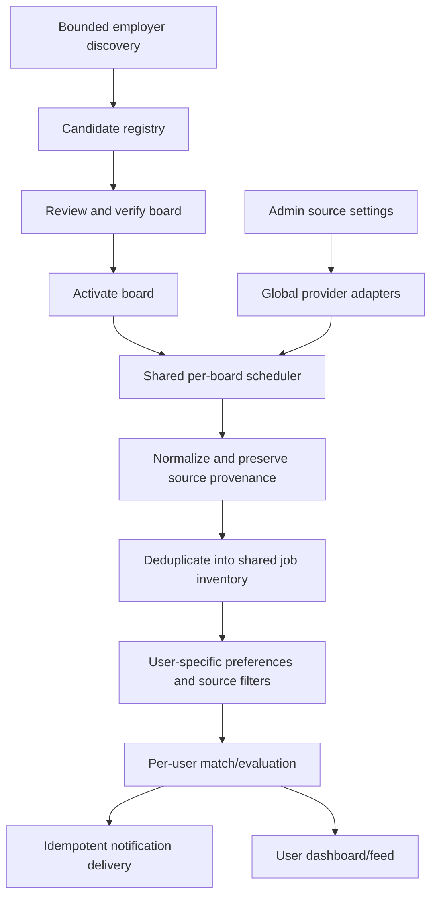

# JobBeeper reference-product reverse-engineering learnings

**Date:** 2026-11-10 (IST)  
**Repository:** `AvinashBhalla/job-beeper`  
**Documentation branch:** `v2-live-radar`  
**Application-code baseline before this documentation update:** `18f219dfab4ad6f2c5ad9b9704da5d3a220f7d37`  
**Status:** Research synthesis and product/architecture decisions. No application code, runtime configuration, deployment, database or notification state changed.

## 1. Executive conclusion

The reference-product investigation confirms that JobBeeper presents a centralized, multi-source job discovery experience to users. It does **not** establish how the private ingestion backend discovers companies, polls boards, uses provider APIs, schedules crawls or achieves its advertised latency.

Our own project already has the right broad architecture: one shared discovery/ingestion system, source/provider adapters, a global employer/board registry, board verification and activation, per-board collection, shared job storage, and per-user matching/notification decisions.

The newly important distinction is that our company-agnostic discovery work is **bounded and admin-triggered**, not an autonomous crawler that continuously discovers and activates every employer. Discovered companies/boards are candidates; they still require review, verification and explicit activation. This is intentional safety, not a defect to remove without evidence.

**Decision:** Continue the existing shared-ingestion architecture. Improve the existing discovery and registry workflow. Do not build a parallel scraper or rewrite the system based on guesses about JobBeeper's private internals.

## 2. Evidence from the reference-product report

The source for this synthesis is the user-provided `JOBBEEPER_REVERSE_ENGINEERING_REPORT.md`, dated 2026-11-10. Its terminology is retained below.

### 2.1 Product behaviour reported as verified

- Public navigation exposes landing, browse, role/location routes, public job details, pricing, guides, login/Google sign-in entry points, policy pages and a Google Play link.
- Public browse results expose role/location search and visible job cards. The report notes a visible cap of 200 results on the inspected backend browse page.
- Public job details expose title, company, location/work mode, posted date, source label and an excerpt; the original listing/application action is sign-in gated.
- Public and authenticated-feed examples display source labels. Labels observed in examples include Own, Naukri, Workable, iCIMS, LinkedIn, Ashby, Lever and Hirist.
- Terms/source examples additionally name Workday, SmartRecruiters, Darwinbox, Greenhouse, Oracle Cloud Recruiting, Instahyre and Wellfound.
- Public copy describes paid alerts, Telegram/browser/app delivery, company blocking/subscriptions and a subscriber-first/public-release concept.

These observations establish product/UI behaviour and source labels. They do not prove that every named provider is currently active, has a dedicated adapter, or is collected through the same mechanism.

### 2.2 Authenticated browser/API evidence reported

The report states that an authenticated feed investigation observed a common JobBeeper application backend list request:

```http
GET /api/user/jobs?page=1&per_page=20&status=matched&sort_by=created_at&sort_order=desc
```

It also describes numeric pagination, server-side keyword search, separate detail metadata/tracker requests and source labels.

**Evidence-handling caveat:** the uploaded Markdown points to a separate local file, `JOBBEEPER_NETWORK_EVIDENCE_2026-11-07.md`, under a Windows `C:\Users\...\Documents\Codex\...` path. The uploaded report does not embed the complete sanitized request/response examples from that file. The endpoint above is therefore recorded as a finding stated by the report; the raw network artifact must be attached or inspected in the follow-up audit before treating its request/response details as independently re-audited.

The common `/api/user/jobs` endpoint proves a common **browser-facing product API** in the observed session. It does not prove that ingestion itself uses one API, one queue, a common crawler, or any particular infrastructure.

### 2.3 What remains unknown about JobBeeper internals

The report does not establish:

- Whether jobs originate from direct job-board APIs, public ATS APIs, career-page crawling, search indexes, sitemaps, manually curated sources or a mixture.
- Whether a central company registry exists, how it is populated, or whether discovery is automated.
- Whether polling is scheduled, event-driven or webhook-based.
- Whether there are queues, worker pools, per-source polling intervals or source-specific rate budgets.
- The actual ingestion, discovery, matching and notification timestamp chain.
- Whether users can disable individual sources in a source-selection panel or how that preference is enforced.

Do not convert these unknowns into claims about the competitor. Marketing metrics such as sources monitored, career pages watched and alerts within minutes are product claims, not proof of backend design or measured latency.

## 3. What our repository already has

The current product roadmap and discovery checkpoint document the following:

- A **shared job discovery engine**: fetch a public job once, then evaluate it independently for each user. Do not run a scraper or scheduler per user.
- Provider-specific adapters and a shared employer/ATS board registry.
- Public employer careers-link/sitemap scanning and ATS detection.
- A bounded Common Crawl CDX sampler for Workday, Keka and Darwinbox, alongside public employer sitemap/careers-link discovery.
- An admin review path for low-confidence employer/board candidates.
- Explicit board verification and activation before scheduled ingestion.
- Per-board scheduling/health work, source-specific rate limits/cooldowns, baselining of first inventory and duplicate/notification safeguards.
- Shared normalized jobs/canonical opportunities and per-user preferences/evaluations/notification delivery.

### 3.1 Company-agnostic discovery is delivered, with deliberate boundaries

PR #67, **Add bounded company-agnostic ATS discovery**, was merged into `v2-live-radar`:

- PR #67 merge commit: `5d6e2b467be102de7056cf6681e1de13b0c3244f`.
- The roadmap records a bounded Common Crawl CDX sampler for Workday, Keka and Darwinbox plus public employer sitemap/careers-link discovery.
- Findings enter a low-confidence candidate/review path.
- Discovery is manual/admin-triggered. Startup performs schema initialization only; it does not start a crawler.
- A discovery run does not silently create employer records, activate boards or send notifications.
- Candidates still need operator review, public-board verification, explicit activation and a silent initial inventory before new-job alerts.

This reduces routine manual company research and avoids adding the same employer separately for every user. It does **not** mean all companies on every ATS are automatically known or activated.

### 3.2 Keep these concepts separate

| Concept | Meaning | Owner |
|---|---|---|
| Source adapter | Knows how to query/parse a provider or marketplace | System/admin |
| Employer/board candidate | Possible company career page and provider identifier found by discovery | System, awaiting review |
| Verified board | Public board/endpoint has been checked and mapped to an employer | Admin/operator approval |
| Active board | Eligible for shared scheduled collection | Admin/operator |
| User source preference | Whether a user wants jobs from that source in their own feed/matches/alerts | Individual user |
| User job preferences | Roles, skills, experience, location and company inclusion/exclusion | Individual user |

An individual user's preference must never disable a global adapter or stop shared polling for other users.

## 4. Product architecture decision

Retain the existing model:



### 4.1 Admin controls

Admins/operators should manage global capabilities:

- Enable/disable a provider adapter globally.
- Start bounded company/ATS discovery scans.
- Review candidate employers and candidate board identifiers.
- Verify and activate individual boards.
- Inspect source/board health, last success, request counts, errors, cooldowns and next poll.
- Configure global rate budgets, schedules and safe activation policies.

A global provider switch is not the same as a user's personal source preference. Disabling a provider globally affects collection for every user and must be an explicit admin action.

### 4.2 End-user source panel

The requested end-user panel should show each supported source with an enabled/disabled preference. That preference should filter the shared inventory for the user's feed, matches and notifications.

Required invariant:

> Turning a source off for User A must not stop its global collector and must not change what User B can receive.

The reverse-engineering report did not verify that the reference product exposes this exact panel. Whether the equivalent UI/API/persistence is already complete in our current code remains a code-audit item; do not infer implementation from a roadmap or feature-branch name.

### 4.3 Data/provenance principles

Preserve source provenance and stable identifiers. The logical model should distinguish:

- Employer/company.
- Provider/source.
- Employer board/tenant/site identifier and verification state.
- Source-native job observation (source ID, source URL, source timestamps and raw-source provenance).
- Canonical job/opportunity (deduplicated shared record).
- User-source preference.
- Per-user match/evaluation.
- Notification ledger/outbox state.

This is a **logical target model**, not a claim that every entity is already implemented as a separate database table. The follow-up code audit must map these concepts to the actual schema before any migration is proposed.

Keep publication and system-observation times distinct. The target event chain is:

```text
source_published_at
source_updated_at
first_seen_at / discovered_at
ingested_at
normalized_at
matched_at
notification_enqueued_at
notification_sent_at
last_seen_at
```

Do not label time-to-alert as real-time unless source publication precision, first discovery, matching and delivery timestamps can be measured independently.

## 5. Priorities after this research

### P0 — Verify the existing implementation before changing it

1. Audit the exact `v2-live-radar` checkout and map the current code/tests for global source switches, per-board activation, user-level source preferences and feed/notification filtering.
2. Confirm that a per-user source preference is isolated to that user and cannot mutate global collector configuration.
3. Map the real database model for employer registry, board registry, source runs, jobs/canonical opportunities, per-user evaluations and notification ledger. Do not add a second copy of an existing entity.
4. Identify which publication/discovery/ingestion/match/notification timestamps are actually persisted and which are only displayed or inferred.
5. Locate and inspect the separate authenticated network evidence file referenced in the reverse-engineering report.

### P1 — Improve discovery quality and operating visibility

1. Improve employer/career-page discovery coverage within permitted public access, robots rules, provider terms and bounded request budgets.
2. Improve ATS identifier resolution and candidate provenance/confidence.
3. Make the review/verify/activate workflow fast for operators without silently activating unverified boards.
4. Measure per-board freshness, unique new-job yield, duplicate rate, 403/404/429/5xx and p50/p95 discovery-to-alert latency.
5. Keep first inventory silent and require a later successful poll/dedupe check before a board becomes eligible for new-job notifications.

### P2 — Product polish and expansion

1. Complete/verify the end-user source preference panel and explain what disabling a source affects.
2. Add public browse/release surfaces only if they fit the product direction and after access/privacy/release policy is explicit.
3. Expand providers one at a time based on verified public access, unique relevant yield, freshness, reliability and operating cost.

## 6. What not to do

- Do not claim to have reverse-engineered JobBeeper's private crawler or scheduler.
- Do not assume a visible source label means a dedicated provider API exists.
- Do not create per-user crawlers or duplicate collection work.
- Do not let a user preference disable a global collector.
- Do not automatically activate low-confidence company/board candidates.
- Do not promise zero-delay alerts; upstream publication, indexing, caching and polling introduce latency.
- Do not use login bypass, CAPTCHA bypass, proxy rotation, TLS impersonation or anti-bot evasion.
- Do not introduce Kafka, Redis, Celery, PostgreSQL or microservices solely because a competitor appears to scale. Follow the current roadmap's measured, incremental engineering approach.

## 7. Evidence and confidence register

| Finding | Classification | Basis / limitation |
|---|---|---|
| Public browse/detail/login/pricing UI and visible source labels | VERIFIED in supplied report | Browser observations described by the report |
| Common authenticated browser-facing `/api/user/jobs` request | VERIFIED as reported; raw evidence not embedded | Separate local network evidence file still needs inspection |
| Exact private ingestion providers/APIs | UNKNOWN | No source-side request evidence in supplied report |
| Competitor company registry/discovery implementation | UNKNOWN | Large coverage metrics do not establish the mechanism |
| Competitor polling cadence/queues/webhooks | UNKNOWN | Marketing latency claims are not measurement |
| Shared collector architecture in our product direction | VERIFIED in repository roadmap | Product roadmap states one shared discovery engine |
| Bounded admin-triggered company-agnostic discovery in our project | VERIFIED in repository documentation and merged PR #67 | Common Crawl CDX + sitemap/career-link sampler; review/verify/activate still required |
| End-user source toggle behaviour in our actual code | UNKNOWN pending exact-branch code audit | Must inspect route, persistence, UI, matching and notification tests |
| Current `v2-live-radar` baseline before these docs | VERIFIED via GitHub branch metadata | `18f219dfab4ad6f2c5ad9b9704da5d3a220f7d37` |

## 8. Repository references and change record

Read these project documents together with this note:

- `docs/PRODUCT_VISION_AND_DELIVERY_ROADMAP.md` — current product/architecture source of truth.
- `docs/ATS_SOURCE_COVERAGE_AND_NEAR_REALTIME_ROADMAP.md` — provider coverage, discovery and polling design.
- `docs/GLOBAL_ATS_DISCOVERY_IMPLEMENTATION_2026-11-09.md` — bounded company/ATS discovery implementation details.
- `docs/JOB_RADAR_HANDOVER.md` — detailed engineering/operations handover.
- `docs/JOB_RADAR_KNOWLEDGE_TRANSFER.md` — compact continuation context.
- User-supplied `JOBBEEPER_REVERSE_ENGINEERING_REPORT.md` — reference-product findings; not yet copied into the repository.

**GitHub state at research review:** PR #67 is merged. PR #69 (stable evaluation-fingerprint fix) is also merged; merge commit/current application-code baseline is `18f219dfab4ad6f2c5ad9b9704da5d3a220f7d37`. The older roadmap note saying PR #69 was open/unmerged is superseded by the current GitHub state and the dated update appended to the roadmap.

**Change scope:** Documentation only. No source code, tests, branches other than the documented target branch, deployment, runtime config, database, notifications, credentials or secrets were changed as part of the research synthesis.

**Next action:** Run the implementation-readiness audit in ChatGPT Desktop against the exact local `v2-live-radar` checkout and the separate network-evidence artifact. Return the audit report before any code implementation.
